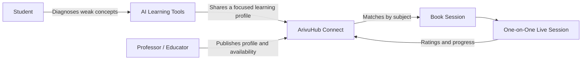
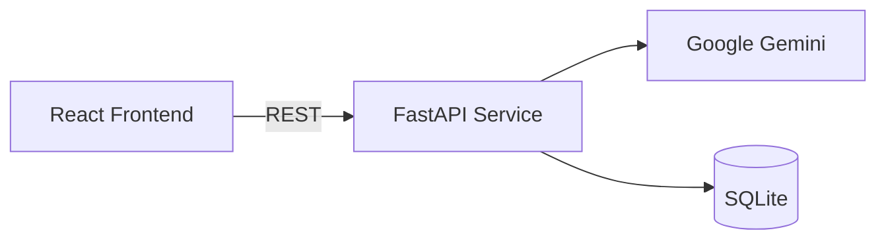

# ArivuHub

**A learning network that connects students with professors and expert educators. Students get the help they need, and educators reach the students who need them.**


---

## Overview

*Arivu* means **knowledge**. ArivuHub is a two-sided platform where both students and educators benefit.

Students often struggle alone with concepts they cannot quite grasp. Meanwhile, professors, lecturers, and subject experts have knowledge to share but no simple way to reach the students who need it. ArivuHub connects these two groups.

- **Students** find verified educators, book one-on-one sessions, and get focused help with the concepts that are holding them back.
- **Educators** find motivated students, offer sessions on their own schedule, build a reputation, and earn from their expertise.

AI-powered learning tools support the platform. They work out exactly where each student is struggling, so every session starts with a clear focus. Educators don't need to spend the first part of a session finding out what the student doesn't understand.

> [!NOTE]
> This repository contains the frontend application. It currently runs on structured sample data. The backend services are under active development (see [Roadmap](#roadmap)).

---

## Student–Educator Connect

This is the core feature of ArivuHub. It is a marketplace where learners and educators find each other, schedule sessions, and learn together.

### How it works



1. **Educators publish a profile** with their subjects, credentials, hourly rate, and availability.
2. **Students find the right educator** by searching and filtering by subject, rating, and verification status.
3. **Students book a session** by picking a date, a time slot, and the concepts they want to work on. Many educators offer a free introductory demo session.
4. **Both sides meet live** through a video session link. The educator already knows which concepts the student needs help with.
5. **Feedback goes back into the platform.** Ratings build each educator's reputation, and retest scores show how much each student has improved.

### Benefits for both sides

| For Students                                              | For Professors & Educators                                     |
| --------------------------------------------------------- | -------------------------------------------------------------- |
| Access to verified professors and subject experts         | A steady stream of students who want to learn                  |
| Free demo sessions before committing                      | Earn income by teaching their subject                          |
| Sessions focused on their specific weak concepts          | Students arrive with a diagnosed learning profile              |
| Flexible scheduling that fits around classes              | Full control over availability and pricing                     |
| Measurable improvement through before-and-after retests   | Build a public reputation through ratings and verified badges  |
| A trusted educator who is available when AI tools are not enough | Reach learners beyond their own institution             |

### Current capabilities

- Educator profiles with credentials, subjects, ratings, verified badges, hourly rate, and availability
- Search and filtering by subject
- Session booking with date, time slot, and focus concept
- Free introductory demo sessions
- A bookings dashboard with upcoming sessions and links to join each call

---

## AI Learning Tools

ArivuHub's AI tools help students study on their own. They also produce the learning profile that keeps every session with an educator focused.

### Learning Lab
- Accepts pasted notes or uploaded documents (`.pdf`, `.docx`, `.txt`)
- Includes ready-made sample topics: Cellular Biology, the JavaScript Event Loop, and Newtonian Physics

### Diagnostic Assessment
- Adaptive quiz with instant feedback and hints
- Finds weak areas concept by concept and points out common misconceptions
- "Explain Like I'm 10" breakdowns that explain hard ideas through real-world analogies

### Revision Suite
- **Flashcards:** 3D flip cards that let the student track which cards they have mastered
- **Mnemonics:** Memory aids explained letter by letter
- **Concept Map:** Interactive SVG graph whose nodes are coloured by mastery level
- **Curated Video Lessons:** Educational videos chosen to match the student's weak areas, with chapter timestamps
- **Summary Notes:** Short, structured revision notes that can be copied with one click

### Progress Tracking
- Retests focus only on concepts the student previously got wrong
- Shows initial and retest scores side by side so improvement can be measured

---

## Tech Stack

| Layer        | Technology                         |
| ------------ | ---------------------------------- |
| Framework    | React 19                           |
| Language     | TypeScript 5.8                     |
| Build Tool   | Vite 6                             |
| Icons        | Lucide React                       |
| Animations   | CSS 3D transforms, canvas-confetti |
| Code Quality | ESLint with typescript-eslint      |

---

## Getting Started

### Prerequisites

- [Node.js](https://nodejs.org/) 18 or later
- npm 9 or later

### Installation

```bash
git clone https://github.com/<your-username>/ArivuHub.git
cd ArivuHub
npm install
```

### Development

```bash
npm run dev
```

The application will be available at `http://localhost:5173`.

### Available Scripts

| Command           | Description                                         |
| ----------------- | --------------------------------------------------- |
| `npm run dev`     | Start the development server with hot reload        |
| `npm run build`   | Type-check and build an optimised production bundle |
| `npm run preview` | Serve the production build locally                  |
| `npm run lint`    | Run ESLint across the codebase                      |

---

## Project Structure

```text
ArivuHub/
├── public/                     # Static assets
├── src/
│   ├── components/
│   │   ├── TutorFinder.tsx        # Educator discovery, search, and filtering
│   │   ├── BookingModal.tsx       # Session scheduling with focus concepts
│   │   ├── MyBookingsView.tsx     # Booked session management
│   │   ├── Sidebar.tsx            # Primary navigation
│   │   ├── Header.tsx             # Topic switcher and user status
│   │   ├── DashboardOverview.tsx  # Progress summary and learning workflow
│   │   ├── LearningLab.tsx        # Content ingestion and quiz generation
│   │   ├── QuizEvaluation.tsx     # Diagnostic quiz and concept analysis
│   │   ├── RevisionTools.tsx      # Flashcards, mnemonics, concept map, notes
│   │   ├── VideoModal.tsx         # Embedded video lesson player
│   │   └── ProgressTracker.tsx    # Targeted retest and score comparison
│   ├── data/
│   │   └── sampleData.ts          # Sample data matching the planned API contract
│   ├── types/
│   │   └── index.ts               # Shared TypeScript domain models
│   ├── App.tsx                    # Application shell and state management
│   ├── index.css                  # Design system and global styles
│   └── main.tsx                   # Application entry point
├── index.html
├── package.json
├── tsconfig.json
└── vite.config.ts
```

---

## Architecture

All domain models are defined in `src/types` as TypeScript interfaces. Sample data in `src/data/sampleData.ts` uses the same interfaces as the planned backend responses. This means moving from sample data to live API calls should require only small changes to the UI components.



---

## Roadmap

**Student–Educator Connect**
- [x] Educator discovery, profiles, and session booking
- [x] Student bookings dashboard
- [ ] Educator onboarding and credential verification
- [ ] Educator dashboard for managing availability, session requests, and earnings
- [ ] Shared learning profiles, so educators see a student's diagnosed weak concepts before the session
- [ ] Integrated payments and payouts
- [ ] Real-time scheduling, notifications, and built-in video sessions
- [ ] Two-way ratings and reviews

**Platform**
- [x] Frontend application covering the full learning workflow
- [ ] FastAPI backend service
- [ ] Gemini-powered generation of quizzes, explanations, and revision material
- [ ] User authentication with separate student and educator roles
- [ ] Persistent progress tracking and session history

---

## Contributing

Contributions, issues, and feature requests are welcome. To contribute:

1. Fork the repository
2. Create a feature branch (`git checkout -b feature/your-feature`)
3. Commit your changes (`git commit -m "Add your feature"`)
4. Push to the branch (`git push origin feature/your-feature`)
5. Open a pull request

Please run `npm run lint` and `npm run build` before you submit.
