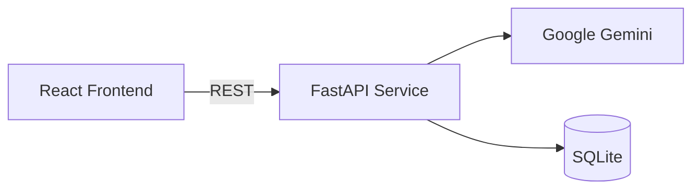

# ArivuHub

**An adaptive learning platform that finds gaps in a student's understanding, helps them close those gaps, and connects them with human tutors when they need more help.**


---

## Overview

Most study tools treat every learner the same way. ArivuHub begins with diagnosis instead. A student provides their study material, and the platform works out which concepts they have not yet understood. Revision then focuses on those weak areas, using several study methods.

The learning workflow follows five steps:

1. **Ingest:** The student provides study notes or documents.
2. **Diagnose:** An adaptive quiz identifies conceptual weak spots and common misconceptions.
3. **Revise:** Targeted revision material is generated for each weak area.
4. **Measure:** A focused retest measures improvement against the initial baseline.
5. **Escalate:** If a concept is still unclear, the student can book a session with a human tutor.

> [!NOTE]
> This repository contains the frontend application. It currently runs on structured sample data. The AI and persistence layer is being built as a separate backend service (see [Roadmap](#roadmap)).

---

## Features

### Learning Lab
- Accepts pasted notes or uploaded documents (`.pdf`, `.docx`, `.txt`)
- Includes ready-made sample topics: Cellular Biology, the JavaScript Event Loop, and Newtonian Physics
- Shows progress at each stage while quiz content is generated

### Diagnostic Assessment
- Adaptive multiple-choice quiz with instant feedback and hints
- Analyses answers at the concept level to find weak areas
- "Explain Like I'm 10" breakdowns that explain hard ideas through real-world analogies
- Points out common misconceptions for each topic

### Revision Suite
- **Flashcards:** 3D flip cards that let the student track which cards they have mastered
- **Mnemonics:** Memory aids explained letter by letter
- **Concept Map:** Interactive SVG graph whose nodes are coloured by mastery level (mastered, needs review, weak spot). Selecting a node shows more detail.
- **Curated Video Lessons:** Educational videos chosen to match the student's weak areas, with chapter timestamps
- **Summary Notes:** Short, structured revision notes that can be copied with one click

### Progress Tracking
- Retests focus only on concepts the student previously got wrong
- Shows initial and retest scores side by side so improvement can be measured

### Tutor Marketplace
- Search tutors and filter by subject
- Tutor profiles show ratings, verification status, and availability
- Booking flow where the student picks a date, a time slot, and the concepts to focus on
- A bookings dashboard lists upcoming sessions with links to join each call

---

## Tech Stack

| Layer        | Technology                         |
| ------------ | ---------------------------------- |
| Framework    | React 19                           |
| Language     | TypeScript 5.8                     |
| Build Tool   | Vite 6                             |
| Icons        | Lucide React                       |
| Animations   | CSS 3D transforms, canvas-confetti |
| Code Quality | ESLint with typescript-eslint      |

---

## Getting Started

### Prerequisites

- [Node.js](https://nodejs.org/) 18 or later
- npm 9 or later

### Installation

```bash
git clone https://github.com/<your-username>/ArivuHub.git
cd ArivuHub
npm install
```

### Development

```bash
npm run dev
```

The application will be available at `http://localhost:5173`.

### Available Scripts

| Command           | Description                                   |
| ----------------- | --------------------------------------------- |
| `npm run dev`     | Start the development server with hot reload  |
| `npm run build`   | Type-check and build an optimised production bundle |
| `npm run preview` | Serve the production build locally            |
| `npm run lint`    | Run ESLint across the codebase                |

---

## Project Structure

```text
ArivuHub/
├── public/                     # Static assets
├── src/
│   ├── components/
│   │   ├── Sidebar.tsx            # Primary navigation
│   │   ├── Header.tsx             # Topic switcher and user status
│   │   ├── DashboardOverview.tsx  # Progress summary and learning workflow
│   │   ├── LearningLab.tsx        # Content ingestion and quiz generation
│   │   ├── QuizEvaluation.tsx     # Diagnostic quiz and concept analysis
│   │   ├── RevisionTools.tsx      # Flashcards, mnemonics, concept map, notes
│   │   ├── VideoModal.tsx         # Embedded video lesson player
│   │   ├── ProgressTracker.tsx    # Targeted retest and score comparison
│   │   ├── TutorFinder.tsx        # Tutor search and filtering
│   │   ├── BookingModal.tsx       # Session scheduling
│   │   └── MyBookingsView.tsx     # Booked session management
│   ├── data/
│   │   └── sampleData.ts          # Sample data matching the planned API contract
│   ├── types/
│   │   └── index.ts               # Shared TypeScript domain models
│   ├── App.tsx                    # Application shell and state management
│   ├── index.css                  # Design system and global styles
│   └── main.tsx                   # Application entry point
├── index.html
├── package.json
├── tsconfig.json
└── vite.config.ts
```

---

## Architecture

All domain models are defined in `src/types` as TypeScript interfaces. Sample data in `src/data/sampleData.ts` uses the same interfaces as the planned backend responses. This means moving from sample data to live API calls should require only small changes to the UI components.



---

## Roadmap

- [x] Frontend application covering the full learning workflow
- [x] Typed domain models and sample data layer
- [ ] FastAPI backend service
- [ ] Gemini-powered generation of quizzes, explanations, and revision material from any content
- [ ] Persistent user progress and session history
- [ ] User authentication
- [ ] Real-time tutor scheduling and video sessions
- [ ] Spaced-repetition scheduling for flashcards

---

## Contributing

Contributions, issues, and feature requests are welcome. To contribute:

1. Fork the repository
2. Create a feature branch (`git checkout -b feature/your-feature`)
3. Commit your changes (`git commit -m "Add your feature"`)
4. Push to the branch (`git push origin feature/your-feature`)
5. Open a pull request

Please run `npm run lint` and `npm run build` before you submit.
